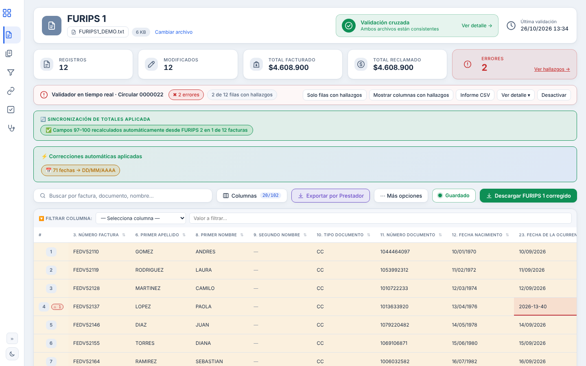
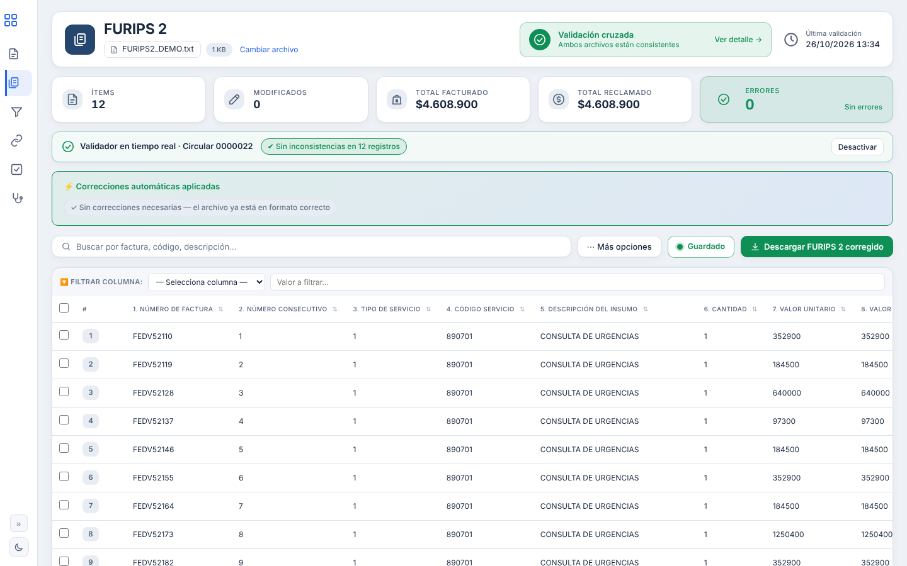
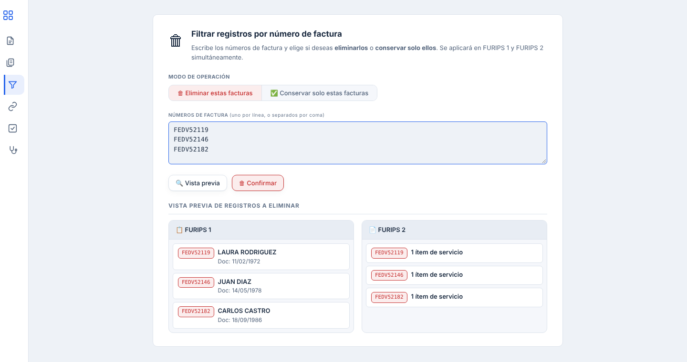
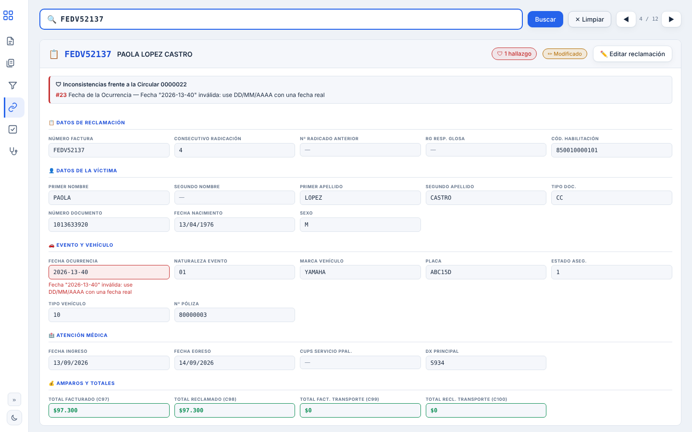
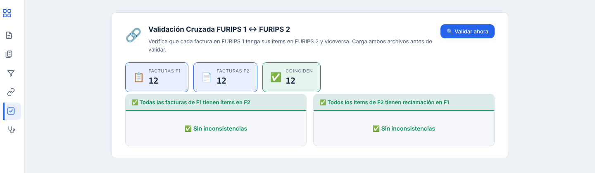
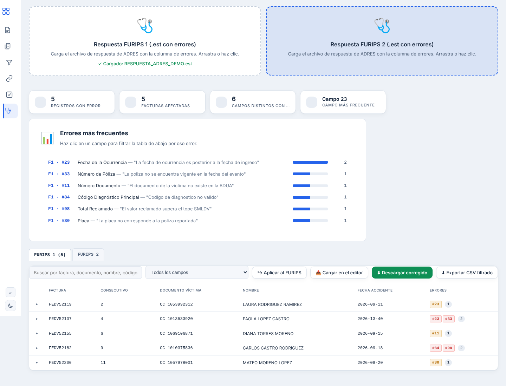

<h1 align="center">📝 Editor FURIPS</h1>

<b>Corrige y valida tus FURIPS antes de que ADRES te los devuelva.</b>

  Validador en tiempo real según la <b>Circular 0000022</b> · Lee la respuesta de ADRES (<code>.est</code>) · Copias de respaldo automáticas

  

Capturas con datos de ejemplo ficticios.

---

## 😩 El problema

Los archivos FURIPS 1 y FURIPS 2 se arman a mano o se exportan del sistema con errores
que nadie ve hasta que ADRES responde con un archivo de rechazos. Entonces toca buscar
factura por factura, corregir en un editor de texto o en Excel, sin saber si la
corrección rompe otra regla, y volver a radicar.

## ✅ La solución

1. **Carga FURIPS 1 y FURIPS 2** y trabájalos como una tabla: buscar por factura,
   documento o nombre, filtrar, ordenar y editar con un clic.
2. **El validador revisa en tiempo real** cada campo contra las reglas de la
   Circular 0000022 y marca en rojo lo que no cumple, incluidos los cruces entre
   FURIPS 1 y FURIPS 2.
3. **Carga la respuesta de ADRES (`.est`)** y ve exactamente qué registros fueron
   rechazados y por qué, con propuestas de corrección para aplicar o descartar.
4. **Vista combinada FURIPS 1 + 2** para revisar una factura completa en una sola pantalla.
5. **Descarga el archivo corregido** y un informe de hallazgos en Excel o CSV.
   Si quedan errores, la herramienta te avisa antes de descargar.

## 🧭 Recorrido por los módulos

### 1. FURIPS 1: reclamación con validador en tiempo real
Cada campo se revisa contra la Circular 0000022 mientras editas. Las fechas se corrigen solas al formato DD/MM/AAAA y lo que no cumple queda marcado en rojo.

### 2. FURIPS 2: servicios facturados
Los ítems de cada factura en una tabla editable. Los totales de FURIPS 1 (campos 97 a 100) se recalculan solos desde aquí.

### 3. Filtrar por factura
Pega una lista de facturas y elige si eliminarlas o conservar solo esas. Se aplica a FURIPS 1 y 2 a la vez, con vista previa y opción de deshacer.

### 4. Vista combinada
Toda la reclamación de una factura en una sola pantalla, con sus inconsistencias explicadas campo por campo.

### 5. Validación cruzada
Confirma que cada factura de FURIPS 1 tenga sus ítems en FURIPS 2, y al revés, antes de radicar.

### 6. Corrección de errores de ADRES
Carga el archivo de respuesta de ADRES (.est) y ve qué facturas fueron rechazadas, por qué campo y cuáles son los errores más frecuentes. Corrige, aplica al FURIPS y descarga el archivo listo.

## 🛟 Sin miedo a perder el trabajo

Copias de respaldo automáticas que puedes restaurar en cualquier momento, y aviso
si intentas cerrar con cambios sin descargar.

## 🔒 Privacidad

Funciona en el computador del usuario. **Los datos de los pacientes no salen a internet.**

## 🛠️ Tecnología

Aplicación de escritorio para Windows en un solo ejecutable: no requiere instalación.

## 📬 ¿La quieres en tu IPS?

Escríbenos a **[nexxtiasoluciones@gmail.com](mailto:nexxtiasoluciones@gmail.com)** y te mostramos cómo
corrige tus propios archivos FURIPS.
